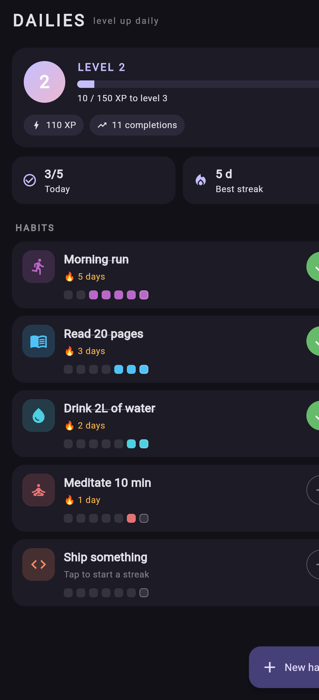
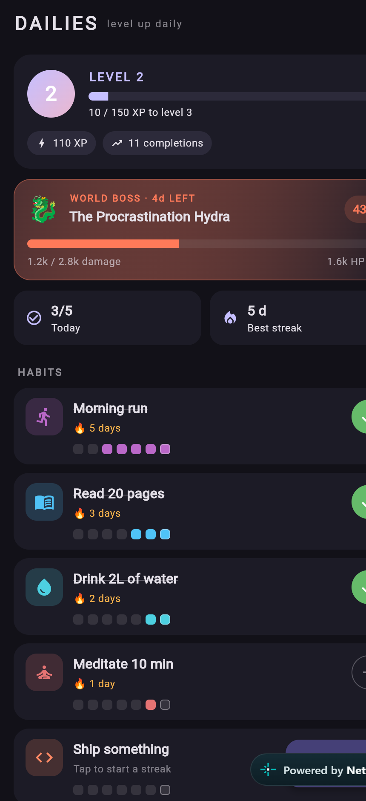
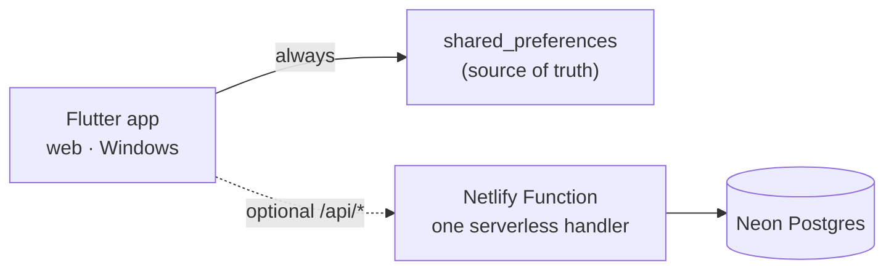

<div align="center">

# 🎯 Dailies

**Your habits are quests. This is the quest log.**

Add a daily · check it off · earn XP · keep the streak alive · fight the weekly boss

[](https://github.com/edwinlabrinth/dailies/actions/workflows/ci.yml)
[](https://flutter.dev)
[](#-getting-started)
[](#-testing)
[](https://dailies-guild.netlify.app)
[](LICENSE)

**[▶️ Play Dailies](https://dailies-guild.netlify.app)** · **[🎬 Demo mode](https://dailies-guild.netlify.app/?demo)** — no install, no password

</div>

---

## 🤔 Why "Dailies"?

In game design, *dailies* are the repeatable quests you're expected to finish
every day. Habits are exactly that — small quests you repeat until they become
who you are. So Dailies treats your habit tracker like a quest log: every
check-off pays out XP, and every ticked day keeps a streak burning. 🔥

**Offline-first, online when you want company.** The tracker has no account
requirement and works with no network at all — your save lives on your device.
The optional **Guild Hall** adds cloud backup, a weekly leaderboard, and a
**world boss** that the whole community damages with every check-off.

## ✨ Features

| | |
|---|---|
| ⚡ **XP for every check-off** | 10 XP per completion, across all habits |
| 📈 **A real level curve** | Level 2 costs 100 XP and each step grows by 50 |
| 🔥 **Midnight-grace streaks** | Your streak survives until the day actually ends |
| 🗓️ **Seven-day week strip** | The past week at a glance, with today ringed |
| ↩️ **Undo a mistake** | Deleted a habit? The snackbar offers to put it back |
| 🎉 **Level-up moments** | Crossing a threshold pops a little celebration |
| 💾 **Offline-first, always** | Local storage is the source of truth; no network required |
| 🏰 **Optional guild hall** | Cloud save + leaderboard with no email and no password |
| 🐉 **A weekly world boss** | Every completion in the guild deals 10 damage; HP scales with active players |
| 🔑 **Sync codes** | A human-readable `ABCD-EFGH-JKLM` code moves your save to another device |
| 🔥 **Guild streak** | Consecutive days on which *somebody* in the guild showed up |
| 🎨 **Material 3 dark UI** | Seeded palette, animated check-off, momentum stats |
| 🧪 **Fully tested** | 50 unit + widget tests, plus 10 end-to-end API checks |
| 🌐 **Web + Windows** | Same codebase, one `flutter run` away |

## 📸 A look at it

<div align="center">



<sub>Demo mode (`?demo`): five habits, a 5-day streak and 110 XP — planted mid-level 2.</sub>

<br /><br />



<sub>Demo mode also previews the guild's weekly world boss: 43% defeated, four days left.</sub>

</div>

## 🎮 How the game works

| Action | Effect |
|---|---|
| Tap a habit | Marks it done today — **+10 XP** |
| Tap it again | Takes the XP back (typos happen) |
| Long-press a habit | Deletes it — the snackbar offers **Undo** |
| New habit | Pick a name and an icon; the color is rolled for you |

| Level | XP needed (cumulative) |
|:-----:|:----------------------:|
| 1 | 0 |
| 2 | 100 |
| 3 | 250 |
| 4 | 450 |
| 5 | 700 |
| 6 | 1,000 |

Each step costs 50 XP more than the last, so entering level `L` needs
`25 × (L − 1) × (L + 2)` XP in total.

**Streaks** count consecutive completed days. If today isn't ticked *yet*, the
streak is measured from yesterday — you don't lose a 🔥 at 9am just because you
haven't run yet. Miss a full day and it resets.

## 🏰 The Guild Hall

Optional. Tap the 👥 icon in the app bar.

| | |
|---|---|
| **Identity** | Pick a guild name. No email, no password — you get a `XXXX-XXXX-XXXX` sync code |
| **Cloud save** | Every change syncs a moment later; claim the code on another device to pull it back |
| **Leaderboard** | Weekly XP for everyone, resetting Monday 00:00 UTC |
| **World boss** | A new boss each week. HP is `700 × active players`; every completion deals 10 damage |
| **Guild streak** | Days in a row with at least one completion anywhere in the guild |

The bosses rotate weekly: the Procrastination Hydra 🐉, the Snooze Golem 🗿, the
Doomscroll Kraken 🐙, the Inbox Wyrm 🐛, the Deadline Djinn 🧞, the Chaos Mimic
🎭 and the Excuse Wraith 👻.

**Security, briefly:** tokens are 256-bit random values stored only as SHA-256
hashes, and sync codes are hashed too. There are no cookies, so CORS is safe.
Anyone holding your sync code can claim the save — treat it like a recovery
code, and rotate it from the guild hall if it leaks.

## 🏗️ Architecture



- **Offline-first.** Local JSON is authoritative. Network failures turn into a
  friendly message; a check-off never waits for the server.
- **One serverless function** serves every route under `/api/*` using the Web
  Fetch API (Netlify Functions v2) and the Neon HTTP driver.
- **Postgres schema** in [`db/schema.sql`](db/schema.sql): `players`,
  `player_tokens`, `habits`, `completions`. A sync replaces a player's snapshot
  in a single atomic transaction.
- **World state is computed on read.** The boss's HP is simply the week's
  completions, so there is no counter to race on.
- **The web build calls `/api` on its own origin**; desktop and the GitHub Pages
  demo point at the production Netlify API.

### API

| Route | Purpose |
|---|---|
| `GET /api/health` | Liveness + database check |
| `POST /api/register` | Create a player → token + sync code |
| `POST /api/claim` | Trade a sync code for a token + cloud habits |
| `GET /api/sync` | Pull profile, habits, stats and world |
| `POST /api/sync` | Push a full snapshot (atomic replace) |
| `POST /api/sync-code` | Rotate the recovery code |
| `GET /api/leaderboard` | Weekly guild ranking |
| `GET /api/world` | Boss + guild stats |

## 🚀 Getting started

You'll need the [Flutter SDK](https://docs.flutter.dev/get-started/install)
(3.38 or newer) and, for the desktop build, Visual Studio with the
"Desktop development with C++" workload.

```bash
git clone https://github.com/edwinlabrinth/dailies.git
cd dailies
flutter pub get

flutter run -d windows   # desktop
flutter run -d chrome    # web
```

The app works fully offline out of the box. The guild hall needs the API below.

### 🏰 Running the backend locally

You need a [Neon](https://neon.tech) (or any Postgres) database.

```bash
npm install
cp .env.example .env     # paste your connection string into DATABASE_URL
npm run db               # create/upgrade tables — safe to re-run
npm run smoke            # 10 end-to-end checks against that database
npm run dev              # netlify dev: app + functions on :8888
```

Deploying:

```bash
flutter build web --release
netlify deploy --prod --dir=build/web
```

The site needs one environment variable, `DATABASE_URL`. Prefer the Netlify
dashboard, or `netlify env:set DATABASE_URL "…"`; older CLI versions echo the
value from `netlify env:import`, so avoid that in shared terminals.

### 🎬 Demo mode

Want to see it populated without typing anything in?

```bash
flutter run -d web-server --web-port=8080
# then open http://localhost:8080/?demo
```

`?demo` seeds five sample habits, a preview world boss and 110 XP. Demo sessions
are throwaway — they never write to storage and never touch the API.

## 🗂️ Project layout

```
lib/
├── main.dart                    # app entry, demo-mode flag
├── theme.dart                   # Material 3 theme, palette, habit colors
├── data/
│   ├── habit_store.dart         # JSON persistence via shared_preferences
│   ├── api_client.dart          # typed client for /api/*
│   ├── guild_controller.dart    # session, sync and guild state
│   ├── online_store.dart        # device token + sync code persistence
│   └── demo_habits.dart         # sample data for ?demo
├── models/
│   ├── habit.dart               # Habit + date keys + streak math
│   ├── habit_icons.dart         # const icon catalog
│   ├── level.dart               # XP economy and level curve
│   └── online.dart              # guild, boss, leaderboard payloads
├── screens/
│   ├── home_screen.dart         # level card, boss banner, habit list
│   └── guild_screen.dart        # join, sync, leaderboard, account
├── utils/
│   └── format.dart              # compact XP/HP numbers
└── widgets/
    ├── add_habit_dialog.dart    # name + icon picker
    ├── habit_tile.dart          # one habit row
    ├── level_card.dart          # level badge + XP progress bar
    └── world_boss_card.dart     # the community boss progress card
netlify/functions/api.mjs        # the whole serverless API
db/schema.sql                    # Neon Postgres schema
scripts/db.mjs                   # applies the schema (npm run db)
scripts/smoke.mjs                # 10 API checks (npm run smoke)
test/
├── app_test.dart                # end-to-end widget tests
├── data/                        # store round-trips, API client
├── models/                      # streaks, XP boundaries, payload parsing
├── screens/                     # guild hall flows
└── widgets/                     # world boss card
```

## 🧪 Testing

```bash
flutter analyze     # zero warnings
flutter test        # 50 tests
npm run smoke       # 10 API checks (needs DATABASE_URL)
```

| Suite | Covers |
|---|---|
| `test/models/habit_test.dart` | date keys, streak reset/grace/gaps, week strip, JSON round-trip |
| `test/models/level_test.dart` | every level boundary, progress math, XP totals |
| `test/models/online_test.dart` | guild/boss/leaderboard payloads, tolerant parsing |
| `test/data/habit_store_test.dart` | save/load round-trip, corrupt payload recovery |
| `test/data/api_client_test.dart` | requests, bearer auth, error mapping, offline failures |
| `test/data/demo_habits_test.dart` | demo dataset stays showcase-ready (110 XP, no future days) |
| `test/screens/guild_screen_test.dart` | register flow, sync code reveal, leaderboard, validation |
| `test/widgets/world_boss_card_test.dart` | boss progress, defeated state |
| `test/app_test.dart` | add/complete/delete/undo habits, XP updates, level-ups, restart persistence, demo mode, week strip |
| `scripts/smoke.mjs` | register → sync → leaderboard → claim → rotate → world, against the real DB (or a deployed API with `API_BASE`) |

CI runs `flutter analyze`, `flutter test`, a web release build, a Windows release
build and a backend syntax check on every push — see
[`.github/workflows/ci.yml`](.github/workflows/ci.yml).

## 🧠 Design notes

- **Offline by default.** One JSON document under the `dailies.habits.v1` key.
  If it ever gets corrupted, the store recovers to an empty list instead of
  crashing on boot.
- **Dates are calendar keys, not timestamps.** Completion days are stored as
  `yyyy-MM-dd`, which keeps streak math honest across time zones and DST.
- **Icons are indices into a const list.** Habits store a small `int` index and
  resolve it to a `const IconData`, so Flutter can tree-shake the icon font —
  a raw codepoint in the model cancels release web builds.
- **Injectable clock and store.** `HomeScreen` takes an optional `clock` and
  `store`, which is how the restart/streak tests stay deterministic.
- **Last-write-wins snapshots.** A sync replaces a player's habits and
  completions in one transaction. The device stays dumb, the schema stays
  honest, and conflicts can never be half-applied.
- **The boss can't be gamed by writes.** Its HP is a read-time aggregate of
  `completions`, so syncing twice changes nothing.
- **Failure is a feature.** Every network call is optional: offline, the web
  build still boots and every local feature works.

## 🗺️ Roadmap

- [x] Optional cloud sync + weekly guild leaderboard
- [x] Weekly world boss with HP that scales with active players
- [ ] Boss modifiers (e.g. double damage on Wednesdays)
- [ ] Rivalries: pin a friend and race their weekly XP
- [ ] Monthly calendar view per habit
- [ ] Local reminders ("your dailies are waiting")
- [ ] Weekly goals — e.g. "3× per week" instead of every day
- [ ] Light theme and a theme picker
- [ ] Streak freeze: bank one missed day per week
- [ ] Export / import a JSON backup
- [ ] Android & iOS targets

## 🤝 Contributing

Issues and PRs are welcome. The quick loop:

```bash
flutter analyze && flutter test
npm run smoke        # if you have DATABASE_URL configured
```

Keep the analyzer at zero warnings, add a test for new logic, and match the
surrounding style. Small, focused commits are appreciated.

See [CONTRIBUTING.md](CONTRIBUTING.md) for setup, the project layout, and the
house rules (calendar date keys, icon indices, offline-first).

## 📄 License

[MIT](LICENSE) © 2026 Edwin Labrinth

<div align="center">

*Now go keep the streak alive.* 🔥

</div>
